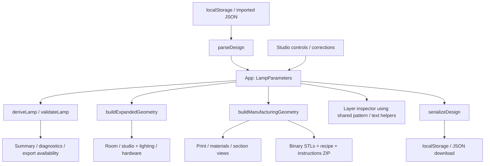

# Architecture

Origami Lamp is a browser application for configuring expandable TPU lampshades, inspecting their compressed material assembly, and downloading manufacturing files. This document describes the implemented system and the contracts that changes must preserve.

Use the [README](../README.md) for setup and product behavior, the [engineering brief](OrigamiLampAgentBrief.txt) for construction intent and acceptance criteria, and [AGENTS.md](../AGENTS.md) for the development workflow. The brief also discusses future possibilities; it is not a list of features already implemented.

## 1. System boundary and runtime

The application is a single React page served by Vite. All parameter editing, geometry generation, validation, rendering, JSON import, and ZIP generation happen in the browser. There is no application server, account system, database, routing framework, or remote design storage.

| Concern | Implementation |
| --- | --- |
| Application and types | React, TypeScript in strict mode, ESM |
| Build and styles | Vite, Tailwind CSS, repository CSS |
| UI primitives | Repository-owned components wrapping Radix primitives |
| 3D presentation | Three.js, React Three Fiber, Drei |
| Geometry operations | Custom boundary meshing, Three.js triangulation, `polygon-clipping` for planar text partitions |
| Optical intersections | `three-mesh-bvh` over a clone of the expanded geometry |
| File packaging | Binary STL writer and `fflate` ZIP compression |
| Verification | Vitest for domain/geometry tests; Playwright and axe for browser behavior |

Dependency ranges and runtime requirements live in [package.json](../package.json); exact versions live in [package-lock.json](../package-lock.json). The current Node requirement is at least 22.12.0. The `@/` alias resolves to `src/` in both TypeScript and Vite.

[`main.tsx`](../src/main.tsx) mounts `App` under React Strict Mode and imports the global stylesheet. [`App.tsx`](../src/App.tsx) coordinates the studio. `StudioPreview` lazy-loads the viewer through React `Suspense`. Geometry and export work remain synchronous on the main thread; no worker is currently implemented. The short delay before export lets the busy state paint but does not make meshing asynchronous.



The diagram shows data flow, not an enforced import graph. In particular, `src/lib` contains both deterministic geometry helpers and rendering helpers that use Three.js. Browser side effects should stay at the application, component, or explicit download boundary.

## 2. Code ownership

| Location | Responsibility |
| --- | --- |
| [`src/App.tsx`](../src/App.tsx) | Canonical parameters, transient studio state, persistence, imports, export actions, diagnostics |
| [`src/components/studio/`](../src/components/studio/) | Controls, summary, preview container, validation summary, and dialog composition |
| [`src/components/parameter-control.tsx`](../src/components/parameter-control.tsx), [`src/lib/parameter-value.ts`](../src/lib/parameter-value.ts) | Shared numeric input/slider editing and commit semantics |
| [`src/lib/lamp.ts`](../src/lib/lamp.ts) | Parameter schema/defaults, layer arithmetic, diagnostics, manufacturing gates, calibration transformation |
| [`src/lib/manufacturing.ts`](../src/lib/manufacturing.ts) | Compressed material solids and contour offsets |
| [`src/lib/cutout-patterns.ts`](../src/lib/cutout-patterns.ts) | Pattern geometry, schedule, recess faces, shared contour coordinates, retained-web calculation |
| [`src/lib/text-projection.ts`](../src/lib/text-projection.ts), [`src/lib/text-font.ts`](../src/lib/text-font.ts) | Vector lettering, perimeter wrapping, conforming material partitions |
| [`src/lib/export.ts`](../src/lib/export.ts) | Versioned recipes, import validation, binary STL encoding, ZIP generation and downloads |
| [`src/lib/printability-fixes.ts`](../src/lib/printability-fixes.ts), [`src/components/printability-checks.tsx`](../src/components/printability-checks.tsx) | Revalidated correction proposals, feedback and undo |
| [`src/lib/preview-geometry.ts`](../src/lib/preview-geometry.ts), [`src/components/lamp-viewer.tsx`](../src/components/lamp-viewer.tsx) | Expanded surface, scenes, manufacturing inspection, camera and rendering fallback |
| [`src/components/layer-inspector/`](../src/components/layer-inspector/) | Pure layer-view model, SVG footprint/section diagrams, navigation and details |
| [`src/lib/mounting.ts`](../src/lib/mounting.ts), [`src/lib/base.ts`](../src/lib/base.ts) | Shared hardware dimensions, mounting fit, base compartment and assembly elevation |
| [`src/components/lamp-mounting.tsx`](../src/components/lamp-mounting.tsx), [`src/components/lamp-base.tsx`](../src/components/lamp-base.tsx) | Separate conceptual mounting and wooden base meshes |
| [`src/lib/wood.ts`](../src/lib/wood.ts), [`src/lib/wood-texture.ts`](../src/lib/wood-texture.ts), [`src/components/wood-box.tsx`](../src/components/wood-box.tsx) | Wood choices, procedural grain and physically scaled timber materials |
| [`src/components/ui/`](../src/components/ui/), [`src/index.css`](../src/index.css) | Shared UI primitives, tokens, layout, focus and responsive behavior |
| [`tests/`](../tests/), `src/**/*.test.ts` | Browser integration tests and colocated unit/geometry tests |
| [`public/`](../public/), [`scripts/`](../scripts/) | Committed site assets and optional asset-generation tools |

## 3. State, editing and persistence

`LampParameters` in `lamp.ts` is the canonical design object. It includes print dimensions and material settings as well as saved appearance choices. Derived values are computed from it rather than persisted as a second editable model.

`App` owns parameters with `useState` and derives `deriveLamp(parameters)` and `validateLamp(parameters)` with `useMemo`. Controls receive values and a typed update callback. Updates create a new parameter object; changing a circle through this callback also synchronizes `depth` to `width`. Geometry calculations use width as the effective depth for circles.

Keep parameter updates immutable. Besides React memoization, text projection uses a `WeakMap` cache keyed by parameter object identity. Mutating an existing object can leave dependent results stale.

The selected view, room style, light on/off switch, camera reset counter, dialog, expanded preview layout, notifications, and export/storage status are transient `App` state. They are not written into the design recipe. Saved light intensity, source type, warmth, and flicker are parameters and do persist.

### Numeric controls and dialogs

`ParameterControl` keeps a temporary text draft separate from the applied value. Valid in-range step-aligned input updates the design live. Blur or Enter commits a rounded/clamped value; Escape discards the pending draft. Imported values can extend a control's suggested range without being silently clamped on load. The UI range is therefore not the entire supported domain; `validateLamp` owns domain limits.

The `studio/types.ts` view modes are `room`, `studio`, `print`, `materials`, and `section`. Dialogs are `export`, `checks`, `guide`, and `layers`. `StudioDialogs` centralizes dialog content and restores focus to the captured opener. `PrintabilityChecks` moves focus to its status feedback when an applied correction removes the originating action.

### Storage and file format

The local storage key is `origamilamp.design.v1`. Initialization passes saved text through `parseDesign`; missing or invalid storage falls back to a fresh copy of `DEFAULT_PARAMETERS`. Every parameter change writes `serializeDesign(parameters)`. Storage errors change the UI status while leaving editing available.

The JSON envelope contains `schemaVersion: 1`, `application`, `units: "mm"`, `parameters`, and descriptive `recipe` metadata. The importer consumes the version and parameter object. It does not treat supplied recipe notes or derived metadata as executable instructions or authoritative geometry.

`parseDesign`:

1. Requires valid JSON, schema version 1, and a parameter object.
2. Iterates the keys in `DEFAULT_PARAMETERS`, accepting only the expected types and finite numbers. Unknown fields are not copied into the resulting parameters.
3. Defaults absent later-added version-1 fields only when listed in `OPTIONAL_V1_SETTINGS`. Explicit `null`, wrong types, or unsupported values remain errors.
4. Rejects scalar/range errors and negative corner radius, while retaining geometric conflicts for live editing and diagnostics.

The file input imposes a 100,000-byte limit before reading; this is a UI boundary, not a limit inside `parseDesign` itself. Local storage and imported files share the same parser, so compatibility changes affect both.

When adding a saved setting, update the type/default, validation, controls, version-1 migration decision, relevant recipe metadata, and import/export tests together. A new scalar diagnostic also needs consideration in the parser's explicit scalar-error set.

## 4. Domain arithmetic, units and validation

Physical design dimensions are millimetres. Rotations are degrees and percentage fields retain their documented percentage meaning. Avoid converting the domain model into scene units.

For `P = pleats`, `h = layerHeight`, `Lt = tpuLayers`, and `Ls = separatorLayers`, `deriveLamp` calculates:

| Quantity | Formula |
| --- | --- |
| Membrane sheets `N` | `2 * P` |
| PLA separators | `N - 1` |
| Membrane thickness | `Lt * h` |
| Separator thickness | `Ls * h` |
| Compressed height | `(N * Lt + (N - 1) * Ls) * h` |
| Free folding span | `bandWidth - innerConnector - outerConnector` |
| Active sloping membranes | `max(0, N - 2)`; the two terminal membranes stay flat |

For the default 24 pleats, this gives 48 membranes, 47 separators, 0.4 mm membrane/separator thicknesses, and 38 mm compressed height. The 480 mm target display height is a separate quantity.

`deriveMounting` interpolates the displayed height between compressed and target height using `expansion`. A one-pleat specimen has no active span and stays at compressed height. The maximum-height estimate in `deriveLamp` is a free-span bound, not a prediction of material forces or achievable deployment. `measuredPitch` supplies planning information and calibration height; it is not a material simulation.

### Three validation boundaries

| Boundary | Behavior |
| --- | --- |
| `parseDesign` | Reject malformed parameters, allow editable geometry conflicts |
| `validateLamp` | Produce `{ id, status, title, detail }` diagnostics with `pass`, `warning`, or `error` |
| `manufacturingErrors` / `buildManufacturingGeometry` | Block all errors and the `experimental-profile` warning before mesh generation |

The UI mirrors the manufacturing restriction for full export: any error or polygon/twist/modulation disables it. Calibration availability is checked against the transformed specimen. The generator enforces its own gate, so bypassing a button cannot export unsupported geometry. Some failures, such as text missing every printable membrane, are discovered during generation and reported by the export action.

Important geometric constraints include a nominal aperture of at least 20 mm, connector widths of at least two intended extrusion widths, sufficient free membrane span, build-volume fit, and source/clamp clearance. Rounded rectangles require `bandWidth + 0.05 < cornerRadius < min(width, depth) / 2 - 0.05` so their inward offsets remain rounded and valid. Patterns add retained-thickness and retained-web constraints. Consult `validateLamp` for the complete limits rather than duplicating them in controls.

Diagnostic IDs are cross-module contracts: the importer, correction engine, and UI depend on them. The layer inspector also enumerates its own `BLOCKING_CHECKS`; new geometry-invalid states need consideration there. `getPrintabilityFix` proposes a new parameter object, revalidates the target and other constraints, and rejects corrections that worsen their checks. It treats printer dimensions, required light clearance, and calibration measurements as inputs to preserve. Physical-validation warnings have no automatic correction. Undo is offered only while the currently applied parameter object is the correction's result.

## 5. Manufacturing geometry

### Coordinates and outputs

`buildManufacturingGeometry(parameters, options)` returns `{ tpu, pla, accent? }` as indexed Three.js `BufferGeometry` objects. The coordinates are **millimetres, XY-centered, Z-up, with the assembly bottom at Z = 0**. PLA and accent TPU retain their registered layer elevations rather than each starting at zero. Callers own these geometries and must dispose of them.

The manufacturing viewer and exporter call this same generator. There is no separate low-fidelity export mesh. Viewer transforms are presentation-only and must never be applied to the saved STL coordinates.

### Plain material construction

The generator supports circles and constant-section rounded rectangles. `offsetContour` creates true normal offsets; for rounded rectangles, corner centers stay fixed while radii and straight edges move inward. Scaling an outline would not preserve the required band widths.

The plain construction partitions the ring at these inward offsets:

```text
0 → outerConnector → bandWidth - innerConnector → bandWidth
```

These delimit the outer joining band, free membrane, and inner joining band. Membrane intervals contain TPU throughout the ring. Separator intervals alternate between an outer TPU join with inward-accessible PLA and an inner TPU join with outward-accessible PLA. The full annular membranes connect through these alternating joins, leaving the central aperture open.

Z boundaries come from integer print-layer counts multiplied by `layerHeight`. Boundary generation emits exposed material faces with shared vertices rather than overlapping independent closed washers. Internal faces are omitted and compatible exposed regions are merged. Patterned and lettered paths use conforming planar partitions and shared edge subdivisions to keep adjacent surfaces connected.

The intended invariants are:

- The unlettered TPU shade is one connected, closed solid. With lettering, the combined base/accent TPU retains the shade volume; each material boundary must remain valid, while letters may create multiple accent components.
- There are exactly `N - 1` separate PLA separators, each accessible from its designated inside or outside opening.
- Material interiors do not overlap, although adjacent parts share interface faces.
- Meshes have consistently oriented closed boundaries, positive volume, and no duplicate or degenerate faces.
- Z boundaries follow the selected layer schedule and the complete assembly retains one shared origin.

### Light-pattern recesses

`cutout-patterns.ts` supplies the layout used by manufacturing, expanded shading, optical tracing, and the inspectors. Despite their name, these cutouts are **thinner TPU regions, not through-holes**. `cutoutLayers` is the number of TPU layers remaining under or over the recess.

The first and last membrane stay full thickness. The pattern schedule begins at membrane index 1; `cutoutEvery` counts membranes, not printer layers. Phase advances across skipped membranes too. Selected odd-indexed membranes have top recesses, selected even-indexed membranes have bottom recesses. Both connect to the neighboring outward-open PLA separator. Recesses widen toward the outer edge and leave the inner folds intact.

Patterned geometry uses phase-specific planar partitions. Separator boundaries conform to the partitions on their neighboring membranes; side walls connect the different perimeter samplings. Minimum retained web checks account for the intended extrusion width. Changes to this layout must agree across the solid generator, layer diagrams, preview masks, and optical maps.

### Lettering as a material partition

`text-font.ts` reads bundled Helvetiker Bold outlines from `src/assets/fonts/`; its license is included there. `text-projection.ts` wraps those vector outlines by continuous outer-perimeter distance and the target deployed height, clips them into membrane cells, and forms complementary base/accent TPU regions with `polygon-clipping`.

Lettering occupies existing membrane volume rather than adding a raised surface. Both connector bands and both terminal membranes retain base TPU. The PLA geometry is taken from the uncolored construction, preserving the separator shape. Text that runs beyond one circumference continues wrapping, with overlapping ink merged.

`height` changes the printed color partition when text is enabled. `expansion` and viewing `rotation` never change it. This is the important exception to treating display settings as independent of print geometry. A projection that misses all printable membranes fails generation rather than exporting an empty accent part.

## 6. Expanded preview and inspection

### Representation boundary

| Representation | Coordinates | Purpose |
| --- | --- | --- |
| Compressed material solids | mm; XY footprint, Z-up | Print inspection and STL export |
| Expanded surface | metres; XZ footprint, Y-up | Approximate deployed appearance |
| Layer diagrams | Nominal millimetre geometry mapped to SVG coordinates | Layer/material explanation |

`buildExpandedGeometry` keeps terminal membranes flat and joining strips flat at the creases. Axial rise consumes the free span, retracting the inner creases toward the outer contour. Twist, modulation, and polygon profiles are appearance studies here. This surface is not a printable watertight solid or a finite-element model.

Preview vertices carry `cutoutCoord` (contour fraction, normalized nominal inset, membrane index) and `cutoutJoin` (the adjoining membrane at a shared crease). These preserve print-space identity while the surface expands or deforms. Patterns, text, and optical thickness must follow these attributes rather than being reconstructed from world height alone.

Manufacturing meshes are displayed with scale `0.001` and an X rotation of `-π/2`. Consequently print Y corresponds to negative viewer Z; text projection and optical code explicitly account for that sign. Preserve the convention when changing mappings or section geometry.

### Views, hardware and fallback

`LampViewer` owns the Canvas, scene environment, camera, controls and error boundary:

- `room` shows the appearance model in the Tatami or Brutalist room; `studio` isolates the same appearance model.
- `print` shows compressed permanent TPU, including accent TPU when present.
- `materials` adds removable PLA.
- `section` clips the same material solids and adds section-cap geometry generated from shared pattern/text helpers.

If manufacturing generation fails, the viewer displays guidance to resolve the geometry checks. If WebGL or rendering fails, a fallback preserves access to the surrounding controls, diagnostics and export workflow.

`deriveMounting` shares clamp dimensions, grip, aperture intrusion, elevation, and mounted-preview eligibility across validation and rendering. `deriveBase` accounts for the optional electronics compartment. `previewFrameDimensions` fits the wooden frame to the expanded geometry bounds. Mounting, spring, wood, box, and source meshes are separate hardware concepts and never enter the manufacturing solids. Their parameters can affect validation or preview placement without changing STL vertices.

The layer inspector is an SVG view, not a WebGL framebuffer readback or slicer. Its pure `model.ts` derives the current membrane/separator layer, join direction, recess occupancy, text sections and diagram coordinates. `pattern-section.ts` and `text-section.ts` also support section inspection. These views reuse shared domain/layout helpers, but still require regression tests when manufacturing rules change because they are not slices extracted from the final STL triangles.

## 7. Light, materials and rendering lifecycle

The lighting pipeline separates source configuration, transmission, shader appearance, and animation:

| Module | Role |
| --- | --- |
| [`lighting.ts`](../src/lib/lighting.ts) | Source dimensions, source placement, color temperature and fit calculations |
| [`light-emission.ts`](../src/lib/light-emission.ts) | Emission samples shared by visible lighting and optical maps |
| [`shade-transmission.ts`](../src/lib/shade-transmission.ts) | Thickness-dependent transmission and vertical shade-glow sampling |
| [`shade-material.ts`](../src/lib/shade-material.ts), [`text-distance-field.ts`](../src/lib/text-distance-field.ts) | Pattern/text shader patches, glyph mask textures, pigment attenuation and shadow coverage |
| [`pattern-lighting.ts`](../src/lib/pattern-lighting.ts) | BVH ray intersections through the expanded shade and finite optical-depth maps |
| [`pattern-light-projection.tsx`](../src/components/pattern-light-projection.tsx) | Optical attenuation applied to actual receiving scene materials |
| [`lamp-light-source.tsx`](../src/components/lamp-light-source.tsx), [`use-lamp-flicker.ts`](../src/components/use-lamp-flicker.ts) | Source meshes, point lights, glow textures and synchronized flicker |
| [`soft-shadows.ts`](../src/lib/soft-shadows.ts), [`shadow-quality.ts`](../src/lib/shadow-quality.ts), [`components/shadow-quality.tsx`](../src/components/shadow-quality.tsx) | Shadow shader filtering and bounded refinement scheduling |

The optical caster clones geometry before building a BVH because BVH construction can reorder triangles. It uses nominal membrane coordinates to determine retained thickness, including the combined TPU thickness at shared joins, and can account for pigment. The production `buildPatternLightMaps` path disables pigment in the caster: native shadow maps already handle lettering, so including ink in the softened optical maps would duplicate its shadow. Optical maps attenuate transmission through the base shade; native shadows also account for hardware and furniture. These calculations remain illustrative, not measured filament photometry.

`PatternLightProjection` patches receiving `MeshStandardMaterial` shaders while skipping the diffuser marked `userData.isTPUDiffuser`. It composes existing shader hooks/cache keys and restores them on cleanup. Shader patches in this subsystem depend on Three.js shader source structure, so Three.js upgrades need shader tests and real browser rendering checks.

The diffuser adds back-face diffuse transmission for ceiling, daylight and studio directional lights, so downward-facing folds do not read as opaque material. Ambient room bounce and the opposite side of hemisphere lighting also transmit through the sheet, keeping the whole diffuser light even far from the bulb. This uses the same retained TPU thickness, shared-crease thickness and glyph pigment as the internal glow. Native front-face lighting, specular response and incoming shadow factors remain intact. Internal point lights use the separate glow map to avoid a hard shading transition at bulb height. The shared `LAMP_OUTPUT.shade` gain keeps bulb brightness and warmth visible against the room fill in both steady and flickering previews. These material-only adjustments leave the room's lighting and cast shadows unchanged.

### Performance and resource ownership

- The Canvas uses `frameloop="demand"`; orbit damping is disabled so a static view can become idle.
- `useLampFlicker` mutates existing source and material intensities instead of updating React state or rebuilding geometry per frame. It requests frames only for active flicker while the page is visible and the canvas is in view. Manufacturing views unmount this animation.
- Shadow quality uses a shared uniform and finite refinement steps. Interaction and animation constrain sampling; it does not require a permanent render loop or shader recompilation for each quality step.
- `patternLightingKey` distinguishes expensive geometry/optical changes from power, flicker, and warmth changes. Add relevant dependencies when extending geometry or pigment behavior; avoid invalidating geometry for unrelated appearance controls.
- Explicitly allocated geometries, text/glow/wood/optical textures, temporary BVH geometry, timers, observers, and patched material hooks have owner cleanup. Preserve that lifecycle when adding effects, especially under React Strict Mode.

## 8. Export and calibration

`calibrationParameters` keeps the cross section and material recipe while reducing pleats to `min(4, pleats)`. It scales target height proportionally unless a measured pitch supplies the specimen height. The calibration package uses these transformed parameters for both geometry and its saved recipe; it does not silently remove unsupported profiles or turn off patterns/text.

`createManufacturingArchive` builds the material geometries and packages:

| Entry | Meaning |
| --- | --- |
| `shade-tpu.stl` | Permanent base-color TPU |
| `shade-text-tpu.stl` | Optional permanent accent TPU |
| `separators-pla.stl` | All removable PLA separator components |
| `design.json` | Versioned parameters and material/process notes for this assembly |
| `READ-ME.txt` | Import, assignment, layer, calibration, mounting and removal guidance |

`geometryToSTL` writes binary triangles using unchanged millimetre coordinates and computes facet normals. Degenerate triangles cause an error. STL does not provide reliable unit or material metadata; the recipe and instructions supply those conventions. All parts must be imported together with their shared origin, without independently centering or dropping the accent/PLA parts onto the bed.

The archive builder disposes its geometries in `finally`. Download helpers create a Blob URL, click a temporary anchor, and revoke the URL after the navigation task. Full and calibration ZIP filenames are `origami-lamp-manufacturing.zip` and `origami-lamp-calibration.zip`; standalone recipes download as `origami-lamp-design.json`.

No 3MF, G-code, printer-specific process profile, automatic supports, raft, prime tower, peel tabs, or mounting hardware is generated. Physical release, folding, strength, achievable deployment and hardware performance remain pending until actual specimens are tested. Software geometry checks do not establish those properties.

## 9. Verification and deployment

Run commands from the repository root:

| Command | Scope |
| --- | --- |
| `npm ci` | Install the committed dependency lockfile |
| `npm run dev` | Local Vite server, normally `127.0.0.1:5173` |
| `npm run typecheck` | TypeScript project checking (`tsc -b`) |
| `npm test` | Vitest `src/**/*.test.ts` in a Node environment |
| `npm run test:watch` | Interactive Vitest watch mode |
| `npm run test:e2e` | Playwright browser integration and accessibility suite |
| `npm run doctor` | Installed React Doctor, telemetry disabled |
| `npm run build` | TypeScript check and production bundle in `dist/` |
| `npm run preview` | Serve the production bundle locally |

There is no `lint` script. Vitest configuration is in [vite.config.ts](../vite.config.ts); browser configuration is in [playwright.config.ts](../playwright.config.ts). TypeScript's project include covers `src` and `vite.config.ts`; browser behavior is exercised separately by Playwright.

Playwright starts Vite on `127.0.0.1:5174` with `--strictPort`, uses one worker and SwiftShader WebGL flags, and may reuse a local server outside CI. Install Chromium with `npx playwright install chromium`, or select an available Chrome installation with `PLAYWRIGHT_CHANNEL=chrome npm run test:e2e`. Failure screenshots/traces and other browser captures belong under ignored `test-results/` and `playwright-report/`.

### Select checks by the changed contract

| Change | Relevant coverage |
| --- | --- |
| Plain geometry, units, export | `src/lib/lamp.test.ts`: topology, analytic volume, layer boundaries, occupancy, separator access, registered STL/ZIP output |
| Patterns | `cutout-patterns.test.ts`, `pattern-settings.test.ts`, `pattern-section.test.ts`, `tests/cutout-patterns.spec.ts` |
| Text | `text-projection.test.ts`, `text-settings.test.ts`, `text-rendering.test.ts`, `text-section.test.ts`, `text-shadow.test.ts`, `text-distance-field.test.ts`, `tests/multicolor-text.spec.ts` |
| Preview and hardware | `preview-geometry.test.ts`, `preview-frame.test.ts`, `mounting.test.ts`, `base.test.ts`, `spring-geometry.test.ts`, plus matching browser specs |
| Corrections and editing | `parameter-value.test.ts`, `printability-fixes.test.ts`, `src/components/layer-inspector/model.test.ts`, `tests/studio.spec.ts` |
| Lighting and shaders | Lighting/transmission/emission/pattern/flicker/shadow/wood unit tests, plus the matching `tests/*lighting*`, `*shadows*`, intensity and flicker specs |

Unit test filenames without a directory above are under `src/lib/`. Geometry tests independently inspect output triangles and file bytes; preserve checks for opposite edge incidence, volume, component counts, registration, material occupancy and appearance-setting independence. Browser tests exercise visible effects, console errors, input behavior, persistence, downloads, keyboard focus, mobile layout and accessibility. They are needed for GPU/shader and interaction changes that a Node test cannot verify.

[`vercel.json`](../vercel.json) configures a static Vite deployment using `npm ci`, `npm run build`, and `dist/`. No application environment variables or catch-all rewrite are required. Hashed assets receive immutable caching; the manifest describes app identity but does not implement offline support. Metadata and crawler assets live in `index.html` and `public/`. Asset regeneration is optional and documented in the README; generated assets are committed, so deployment does not run the Swift or capture scripts.

## 10. Extending the system

For a new parameter, follow it from `LampParameters` through defaults, validation, persistence compatibility, controls, relevant calculations, cache keys, inspection, export notes and tests. Keep the distinction between appearance, validation inputs, and actual printable geometry explicit; the target-height/text dependency shows why field names alone are insufficient.

For a new printable profile, implement valid shared connector contours, normal offsets, material partitions and accessible separators before enabling export. Updating only `previewContour` does not establish a printable construction. For pattern or text changes, verify manufacturing meshes, layer/section diagrams, expanded surface masks and cast-light behavior agree.

For renderer changes, preserve idle rendering and cleanup, then check both room styles, the studio, relevant manufacturing modes, light-off behavior, and browser errors. For UI changes, reuse the existing parameter and Radix components, preserve focus/keyboard behavior and mobile bounds, and keep controls usable when WebGL fails.

Update this document when module ownership, geometry conventions, recipe compatibility, rendering contracts or deployment behavior changes. Keep command-level instructions in the README and concise development rules in `AGENTS.md` aligned with it.
